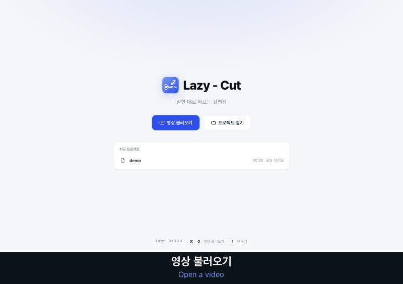

# Lazy - Cut (레이지 컷)

**영상을 문서처럼 편집하세요. 단어·무음·NG를 한눈에 보고, 키 하나로 잘라요.**

[English](README.en.md) · **한국어**



Lazy - Cut은 영상을 받아써서 단어 칩으로 된 자막 줄로 펼쳐 보여줘요. 단어를 지우면 그 부분 영상이 잘려요.
무음, 군말, 다시 말한 NG 테이크를 찾아주고, 끝나면 **프레임 단위로 정확하게 자른 mp4 + SRT 자막**으로 내보내요.
모든 작업은 **내 Mac 안에서만** 해요. 영상이 인터넷에 올라가지 않아요.

## 이런 걸 할 수 있어요

- **글자로 컷편집**: 단어 칩을 지우면 그 부분 영상이 잘려요. 한 번 더 누르면 되살아나요.
- **한눈에 보는 화면**: 썸네일이 있는 클립 카드, 파형 타임라인, 남긴 부분과 자른 부분이 색으로 구분돼요.
- **무음 구간 줄이기**: 몇 초 이상인 무음을 한 번에 줄여요.
- **NG·말더듬 표시**: 다시 말한 테이크와 말더듬을 찾아 표시해요. 마지막 테이크를 남기는 게 기본이에요.
- **읽기 좋은 자막**: "생각하는 / 일은"처럼 의미가 끊기지 않게 줄을 나눠요. 자막은 직접 고칠 수 있어요.
- **키보드만으로 편집**: 재생 위치에서 자르기, 클립 앞뒤 잘라내기, 구간 찍어 자르기, 경계 미세 조정
- **내보내기**: 컷한 mp4(원본 화질, 하드웨어 인코딩) + SRT. CapCut, 프리미어, 파이널컷에 바로 쓸 수 있어요.

## 필요한 것

- Apple Silicon Mac (M1 이상). 인텔 Mac은 안 돼요.
- macOS 13.5 이상
- 여유 공간 약 4GB (프로그램 약 1GB + 음성인식 모델 약 1.5GB)
- Google Chrome 권장 (없으면 기본 브라우저로 열려요)

## 설치

1. **Releases**에서 `Lazy-Cut-<버전>.zip`을 받아 압축을 풀어요.
2. **`install.command`를 우클릭 → 열기**로 실행해요. 처음엔 그냥 더블클릭하면 "확인되지 않은 개발자" 경고로 막혀요.
3. 터미널 창에 **"설치 완료!"**가 뜰 때까지 기다려요. 처음엔 몇 분 걸려요.
   - 개발자 도구(Xcode 명령줄 도구) 설치 창이 뜨면 설치한 뒤 `install.command`를 한 번 더 실행하세요.
4. Spotlight(⌘ + 스페이스)나 Launchpad에서 **Lazy - Cut**을 열어요.

처음 받아쓰기할 때 음성인식 모델(약 1.5GB)을 한 번 내려받아요.

## 쓰는 순서

1. **영상 불러오기** → 받아쓰기 시작. "빠르게"(turbo)를 추천해요. 17분 영상이면 4~5분 걸려요.
2. **컷**: 단어를 클릭하고 **Delete**. 지운 부분은 빨갛게 표시되고 미리보기에서 건너뛰어요.
3. **무음 구간 줄이기**: 예를 들어 "0.15초 이상 무음 → 0초"로 하면 말 사이가 딱 붙어요.
4. **추천 확인**: **군말**, **NG·반복** 창에서 추천 목록을 보고 한 번에 지울 수 있어요.
5. **자막 다듬기**: 단어를 더블클릭해서 고치거나, 클립 아래 자막 줄을 직접 고쳐요.
6. **내보내기**: 원본 옆에 `○○ 컷편집.mp4`와 `.srt`가 저장돼요.

편집 내용은 영상 옆 `.lazycut` 파일에 자동으로 저장돼요.

## 단축키

| 키 | 하는 일 |
|---|---|
| Space | 재생 / 일시정지 |
| ← → / ↑ ↓ | 이전·다음 단어 / 클립 (⇧ 누르면 선택 넓히기) |
| Delete | 삭제 / 되살리기 |
| Enter | 클립 나누기 (자막 칸에서는 커서 위치에서 나누기) |
| ⇧ Enter / ⇧ ⌫ | 뒤쪽을 다음 클립으로 / 앞 클립에 붙이기 |
| ⌘ E / ⌘ ⇧ E | 다음 / 이전 클립과 합치기 |
| C · 타임라인 더블클릭 | 재생 위치에서 자르기 (단어 중간도) |
| Q / W | 클립 처음~재생 위치 / 재생 위치~끝 잘라내기 |
| I → O → X | 시작점·끝점 찍고 그 구간 잘라내기 |
| T | 무음 자리에 자막 넣기 |
| J / L (⇧ 2초) · , / . | 0.5초 이동 · 1프레임 이동 |
| ⌥ A S D F (⇧ 누르면 0.25초) | 선택한 단어의 시작·끝을 0.05초씩 옮기기 |
| F2 · 더블클릭 | 단어 고치기 |
| ⌘ Z / ⌘ ⇧ Z | 되돌리기 / 다시 실행 |
| ⌘ F | 찾아 바꾸기 |
| ? | 전체 단축키 보기 |

## 문제가 생기면

- **창이 안 떠요**: 앱을 다시 실행하거나 Chrome 창을 새로고침(⌘R)하세요.
- **잘린 곳에서 미리보기가 끊겨요**: 프로젝트를 열면 뒤에서 가벼운 미리보기 사본을 만들어요. 다 되면 자동으로 바뀌어요.
- **받아쓰기가 느려요**: "빠르게"(turbo)를 쓰세요. "정확하게"(large-v3)는 영상 길이만큼 걸려요.
- **로그 위치**: `~/Library/Logs/LazyCut/`

## 업데이트 · 제거

- **업데이트**: 새 버전 zip을 풀고 그 안의 `install.command`를 다시 실행하세요. 프로젝트는 그대로 남아요.
- **제거**: `uninstall.command`를 우클릭 → 열기. 앱과 캐시를 휴지통으로 옮겨요. 영상과 `.lazycut` 프로젝트는 건드리지 않아요.

## 개발자용

```bash
/usr/bin/python3 -m venv .venv && .venv/bin/python -m pip install -r requirements.txt
./run_dev.command                      # 소스에서 바로 실행
.venv/bin/python -m unittest tests.test_server
```

Python 3.9 + 순수 JS 화면(빌드 과정 없음). 음성인식은 mlx-whisper, 영상 처리는 imageio-ffmpeg의 ffmpeg를 써요.
